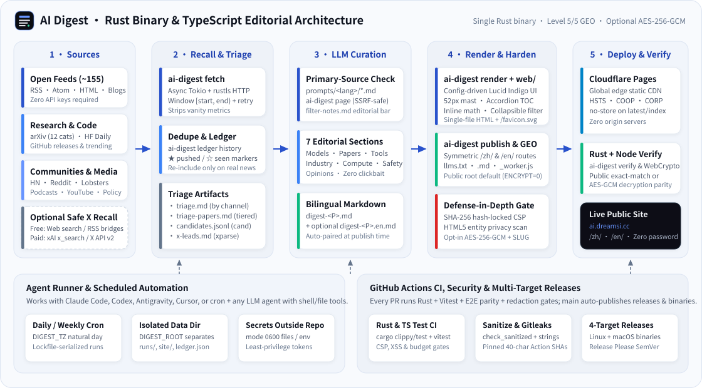

<div align="center">

# AI DIGEST

**An agent-driven pipeline that turns ~150 sources into a daily and weekly AI digest — rendered to a single-file HTML and published as an encrypted static site.**

[](https://github.com/eatingDream/ai-digest/actions/workflows/ci.yml)
[](LICENSE)


English | [简体中文](README.zh-CN.md)

[Live demo](https://ai-digest-demo.pages.dev) — password `demo` · [English](https://ai-digest-demo.pages.dev/en/) · [简体中文](https://ai-digest-demo.pages.dev/zh-CN/)


<sub>A rendered issue built from the synthetic data in <code>examples/</code>. English and Simplified Chinese are both supported (<code>DIGEST_LANG</code>).</sub>

</div>

## How it works

<p align="center"></p>

1. **Wide recall & triage (`fetch/`)** — pulls ~155 read-only open sources in parallel (`fetch/sources.toml`, no API keys), deduplicates, tracks pushed (★) / seen (☆) history in `fetch/ledger.py` so items repeat only on substantive new developments, and writes `triage.md`, `triage-papers.md`, and `candidates.jsonl` (plus optional capability-gated X/Twitter search via `fetch/x-recall.md`).
2. **Content-first LLM curation (`prompts/<lang>/`)** — platform-agnostic daily/weekly prompts (with a lightweight papers prefilter) verify primary sources against `filter-notes.md` and write seven sections (`Models`, `Papers`, `Tools & Projects`, `Industry & Products`, `Compute & Infrastructure`, `Safety & Policy`, `Opinion & Essays`) — selected by substance, never popularity counts.
3. **Single-file HTML reader (`render_html.py`)** — emits self-contained HTML with a full-title sidebar TOC, instant client-side keyword/tag filtering, `#fragment` deep links after decryption, light/dark themes, and bilingual support (`DIGEST_LANG=en|zh-CN`, `--md-en` single-page toggle, or `LANG_ALT` companion links).
4. **Encrypted static hosting (`publish.py`)** — encrypts every page client-side (AES-256-GCM, PBKDF2-SHA256, 600k iterations, gzip), generates static `/<slug>/{daily,weekly,}/latest` redirects in `_redirects`, runs a pre-publish privacy scan, deploys incrementally to Cloudflare Pages, and decrypt-verifies each page via `verify_decrypt.mjs`.

## Quick start

Requirements: Python 3.11+ (CI uses 3.12), Node 20 + `npx` (only for `wrangler` deploys and `verify_decrypt.mjs`).

```bash
python3 -m venv .venv && . .venv/bin/activate
pip install -r requirements-dev.txt          # requests, lxml, markdown, cryptography, pytest

# 1. Render a sample issue (use --md-en to bundle zh-CN + en into one toggleable page)
python3 render_html.py examples/sample-digest.en.md /tmp/sample.html      # add --lang zh-CN for Chinese
python3 render_html.py examples/sample-digest.zh-CN.md /tmp/bilingual.html --md-en examples/sample-digest.en.md

# 2. Build the encrypted demo site (no deploy, no secrets; decrypt-verified during build)
DIGEST_DEMO_PASSWORD='demo' python3 publish.py --demo --out dist/         # dist/en/ + dist/zh-CN/ (--lang for single)

# 3. Run the tests
pytest -q
```

### Run your own digest

```bash
# 1. Configure site (generates site/CONFIG with a random 22-char SLUG; set LANG=en or zh-CN)
python3 publish.py --init                                # or: cp site/CONFIG.example site/CONFIG
install -m 600 /dev/stdin ~/.config/ai-digest/site-password   # paste 16+ char password, then Ctrl-D
export CLOUDFLARE_API_TOKEN=...                          # scope: Account · Cloudflare Pages · Edit

# 2. Fetch candidates (set DIGEST_TZ first; GITHUB_TOKEN/GH_TOKEN optional for higher API limits)
python3 fetch/fetch.py --daily                           # weekly: --weekly

# 3. Curate with an agent: run prompts/en/daily.md (or weekly.md; prompts/zh-CN/ for Chinese) → digest-<P>.md

# 4. Publish (auto-discovers sibling <stem>.en.md on zh-CN sites or pass --md-en; writes static latest redirects)
python3 publish.py --issue daily/2026-01-15 --md digest-2026-01-15.md
```

See [fetch/README.md](fetch/README.md) for fetch options, channels, and helper CLIs, and [site/README.md](site/README.md) for encryption details, `latest` routes, `--rebuild`, `--rerender-all`, `--rotate-password`, and `--remove`.

## Use with AI agents

[AGENTS.md](AGENTS.md) is the entry point for coding agents (repo map, pipeline, conventions, safety rules). To run a digest, open the repo root in any agent runner with shell and file tools, set `DIGEST_LANG` and `DIGEST_TZ`, and run `prompts/<lang>/{papers,daily,weekly}.md` (each starts with a run contract; CLIs expose `--help` and `--json`). Read-only X/Twitter tools (`search_posts_all`, `get_users_posts`, etc.) are **optional**: without them, prompts cleanly skip X recall and curate from the open feeds; if available, customize `<account_1>` / `<zh_account_1>` in `fetch/x-recall.md` and `x-sources.md` (unreplaced placeholders are skipped automatically).

## Configuration

Environment variables take precedence over `site/CONFIG`.

| Variable | `CONFIG` key | Description | Default |
|---|---|---|---|
| `SITE_DOMAIN` | `DOMAIN` | Site domain | `digest.example.com` |
| `SITE_SLUG` | `SLUG` | Unguessable path prefix (`>= 8` URL-safe chars; never change after publishing) | random (`--init`) |
| `CF_ACCOUNT_ID` | `ACCOUNT_ID` | Cloudflare account ID | — |
| `CF_ZONE_ID` | `ZONE_ID` | Zone of the domain (optional) | — |
| `CF_PAGES_PROJECT` | `PROJECT` | Cloudflare Pages project name | `ai-digest` |
| `CLOUDFLARE_API_TOKEN` / `_FILE` | — | Deploy token (Pages · Edit only) | — |
| `DIGEST_SITE_PASSWORD_FILE` | — | Site password file (mode 600) | `~/.config/ai-digest/site-password` |
| `DIGEST_SITE_SALT_FILE` | — | PBKDF2 salt file (auto-generated) | `~/.config/ai-digest/site-salt` |
| `DIGEST_LANG` | `LANG` | Digest & site UI language: `en` or `zh-CN` (`--lang` overrides) | `en` |
| `DIGEST_LANG_ALT` | `LANG_ALT` | Optional companion site URL/path in the other language (e.g. `zh-CN:/zh-CN/`) | — |
| `DIGEST_ROOT_LATEST` | `ROOT_LATEST` | Opt-in root `/latest`, `/daily/latest`, `/weekly/latest` 302 redirects (`1`/`true`/`yes`/`on`; slug-scoped `/<slug>/...latest` aliases are always generated) | `0` (off) |
| `DIGEST_TZ` | — | IANA time zone defining a natural calendar day | `UTC` |
| `DIGEST_ROOT` | — | Working directory for `runs/`, `html/`, `site/`, `ledger.json`, `logs/`, `state/` | repo root |
| `LEDGER_PATH` | — | Explicit path to `ledger.json` (auto-created on first `ledger.py add`) | `<DIGEST_ROOT>/ledger.json` |
| `DIGEST_PREFERENCES_FILE` | — | Topic ranking weights JSON (see `fetch/preferences.example.json`) | `fetch/preferences.json` |
| `DIGEST_PRIVACY_PATTERNS_FILE` | — | Extra regexes checked before publishing | `site/privacy-patterns.txt` |
| `DIGEST_DEMO_PASSWORD` | — | Password for `publish.py --demo` | — |
| `GITHUB_TOKEN` / `GH_TOKEN` | — | Optional, raises GitHub API limits during fetch | — |

Sources live in `fetch/sources.toml`; selection rules live in `filter-notes.md`.

## Contributing & License

Pull requests are welcome (`main` is protected; see [CONTRIBUTING.md](CONTRIBUTING.md) and [SECURITY.md](SECURITY.md)). CSS design tokens in `render_html.py` are adapted from [AIHOT](https://github.com/KKKKhazix/AIHOT) (MIT, © 2026 数字生命卡兹克; see [THIRD_PARTY_NOTICES.md](THIRD_PARTY_NOTICES.md) and [licenses/AIHOT-MIT.txt](licenses/AIHOT-MIT.txt)). Licensed under [MIT](LICENSE).
