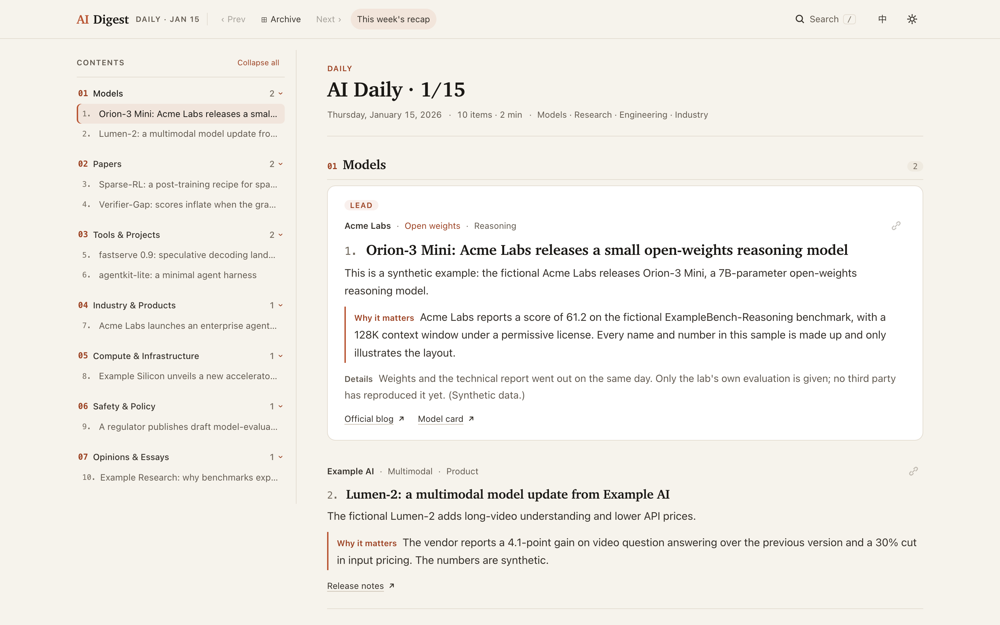

<div align="center">


# AI Digest

**A single-binary Rust + TypeScript editorial pipeline that turns ~155 open AI sources into a daily & weekly digest published as a hardened, GEO-ready static site.**

[](https://github.com/eatingDream/ai-digest/actions/workflows/ci.yml)
[](https://github.com/eatingDream/ai-digest/releases)


[](LICENSE)

English | [简体中文](README.zh-CN.md) · [Live Site](https://ai.dreamsi.cc) · [Releases](https://github.com/eatingDream/ai-digest/releases) · [AI Guide (`llms.txt`)](llms.txt)

<picture>
  <source media="(prefers-color-scheme: dark)" srcset="docs/screenshot-dark.en.png">
  <source media="(prefers-color-scheme: light)" srcset="docs/screenshot.en.png">
  
</picture>

</div>

## What It Is (and Isn't)

**AI Digest** is an open-source, self-contained Rust CLI (`ai-digest`) + modern editorial web reader for fetching frontier AI sources, guiding any LLM agent to curate daily/weekly Markdown briefings, and deploying a fast, privacy-scanned static site to Cloudflare Pages.
It is **not** a hosted SaaS newsletter, a cookie-scraping X bot, or a heavy JS framework — everything ships in one native binary and zero-dependency single-file HTML pages.

## Features

- **Single self-contained Rust binary** — async source recall (`fetch`), deduplication ledger (`ledger`), curation helpers (`cand`, `page`, `xparse`), HTML renderer (`render`), static site & GEO publisher (`publish`), and dual-runtime verifier (`verify`) with zero runtime interpreter dependencies.
- **Broadsheet editorial reader** — config-driven Lucid Indigo dark/light themes (`web/ui-theme.json`) with zero white flash and circular view-transition reveal, issue summary lead, highlighted `LEAD` story with multi-source citation pills, 3-tier font scaling (`S` / `M` / `L`), always-expanded Cmd+F-friendly sidebar TOC, instant distance-adaptive jumps, anchor-locked ZH/EN language switching, unified pill search drawer (`/`), keyboard navigation (`j`/`k`/`[`/`]`), and inline LaTeX math.
- **Native bilingual routes & static `latest`** — pairs `<stem>.en.md` into symmetric `/zh/` & `/en/` site trees (or single-file `--md-en` bilingual HTML) with `hreflang` alternates (including `x-default`) and direct HTTP 200 `/daily/latest` and `/weekly/latest` pages.
- **Public-first Level 5/5 GEO & Agent Readiness** — emits `robots.txt` Content Signals, `sitemap.xml`, `llms.txt`/`llms-full.txt`, Atom (`/feed.xml`), RSS 2.0 (`/rss.xml`), and JSON Feed 1.1 (`/feed.json`) feeds, JSON-LD structured data, `.md` mirrors, `/.well-known/api-catalog` (RFC 9727), Agent Skills discovery, and a Cloudflare Pages `_worker.js` supporting `Accept: text/markdown` and `GET`/`HEAD`/`QUERY` `/.well-known/search`.
- **Hardened security & opt-in encryption** — build-time SHA-256 hash-locked CSP (zero `'unsafe-inline'` scripts), strict security headers, Markdown XSS neutralization, entity-aware privacy scanning, and one-flag client-side AES-256-GCM encryption (`--init --encrypt`).
- **~155 zero-key open sources** — RSS/Atom, arXiv, Hugging Face, GitHub, lab blogs, HN, and Reddit out of the box, with optional read-only X recall requiring no personal cookies.

## Quick Start

Download a prebuilt binary from [GitHub Releases](https://github.com/eatingDream/ai-digest/releases), or build from source (Rust 1.88+):

```bash
AI_DIGEST_REQUIRE_WEB_DIST=1 cargo build --release --locked
./target/release/ai-digest publish --demo --out dist/          # offline bilingual demo site
./target/release/ai-digest render examples/sample-digest.en.md /tmp/sample.html
```

To run your own daily/weekly pipeline:

```bash
ai-digest publish --init && ai-digest fetch --daily
# Curate with your agent using prompts/en/daily.md -> digest-YYYY-MM-DD.md
ai-digest publish --issue daily/YYYY-MM-DD --md digest-YYYY-MM-DD.md
```

## For AI Agents

AI Digest is built to be operated and read directly by coding agents (Claude Code, Codex, Cursor, OpenCode, Antigravity):

```bash
npx skills add eatingDream/ai-digest
```

Point your agent to [`llms.txt`](llms.txt), [`skills/ai-digest/SKILL.md`](skills/ai-digest/SKILL.md), [`docs/ai-guide.md`](docs/ai-guide.md) (full config table, env vars, CLI matrix & safe X recall), or [`AGENTS.md`](AGENTS.md). Every public deployed site also exposes:

- `/llms.txt`, `/llms-full.txt`, and `/.well-known/api-catalog` (RFC 9727 endpoint catalog)
- `Accept: text/markdown` content negotiation, per-page `.md` mirrors, and `/.well-known/search?q=<query>`
- `/feed.xml` (Atom), `/rss.xml` (RSS 2.0), `/feed.json` (JSON Feed 1.1), `sitemap.xml` with `hreflang`, and JSON-LD schema markup

## Safety & Privacy

- **SSRF-hardened & read-only recall** — DNS-pinned HTTP fetching blocks private/link-local CIDRs and never requires personal social cookies.
- **Zero-secret repository hygiene** — credentials stay outside the repo (`chmod 0600`); an HTML5 entity-aware privacy scanner blocks accidental leaks before publishing.
- **Strict hash-locked CSP** — every executable inline script is SHA-256 hashed into `_headers` at build time with zero `'unsafe-inline'` scripts.
- **Private mode isolation** — enabling `ENCRYPT=1` automatically disables public GEO endpoints and enforces `Disallow: /` + `noindex`.

## Documentation

- [Architecture Diagram](docs/architecture.en.svg) · [Agent & Operations Guide](docs/ai-guide.md) · [AGENTS.md](AGENTS.md)
- [Fetch & Channels](fetch/README.md) · [Site & Publishing](site/README.md) · [Safe X Recall](fetch/x-recall.md)
- [Contributing](CONTRIBUTING.md) · [Security Policy](SECURITY.md) · [Third-Party Notices](THIRD_PARTY_NOTICES.md)

## License

[MIT](LICENSE) — CSS design tokens adapted from [AIHOT](https://github.com/KKKKhazix/AIHOT) (MIT; see [THIRD_PARTY_NOTICES.md](THIRD_PARTY_NOTICES.md)).
