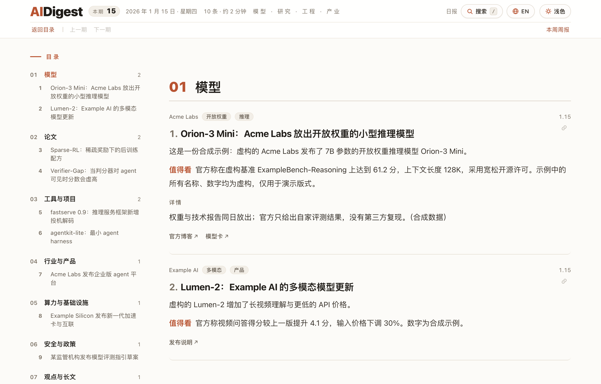

<div align="center">


# AI Digest

**由 agent 驱动的 AI 日报 / 周报流水线：汇集约 155 个公开信源，渲染为单文件杂志级阅读器，并发布为纵深加固的静态站点。**

[](https://github.com/eatingDream/ai-digest/actions/workflows/ci.yml)
[](https://github.com/eatingDream/ai-digest/releases)
[](LICENSE)


[English](README.md) | 简体中文

**[在线演示](https://ai-digest-demo.pages.dev)** · [中文归档](https://ai-digest-demo.pages.dev/zh-CN/) · [最新中文日报](https://ai-digest-demo.pages.dev/zh-CN/daily/latest) · [English Index](https://ai-digest-demo.pages.dev/en/) · [Latest EN Daily](https://ai-digest-demo.pages.dev/en/daily/latest)

<picture>
  <source media="(prefers-color-scheme: dark)" srcset="docs/screenshot-dark.zh-CN.png">
  <source media="(prefers-color-scheme: light)" srcset="docs/screenshot.zh-CN.png">
  
</picture>

<sub>由 <code>examples/</code> 中的合成数据自动渲染。支持浅色暖纸与深色暖炭黑陶土双主题自动适配，以及完整中英双语体验。</sub>

</div>

## 核心亮点

- **暖纸杂志级单文件阅读器（`render_html.py`）** — 暖纸浅色与暖炭黑陶土深色双主题、知乎式全宽自动显隐顶栏（下滑隐藏、上滑或停顿 3 秒浮现）、收拢进顶栏的折叠搜索抽屉（快捷键 `/`，正文顶部零占位）与按频次排序的原子去重标签、丝滑跟滚的完整标题侧栏目录、锚点直链复制、可点击回首页的 `AI Digest` 标识与内置 `/favicon.svg`。
- **原生双语路径与静态 `latest` 入口** — 自动配对同目录 `<同名>.en.md` 生成对称 `/zh/` 与 `/en/` 站点目录（亦支持 `--md-en` 单页双语或 `LANG_ALT` 伴生互链），直接以 HTTP 200 提供 `/daily/latest`、`/weekly/latest`、`/zh/daily/latest`、`/en/daily/latest`（`no-store` 实时更新，URL 稳定不跳转）。
- **默认公开、纵深加固的静态发布（`publish.py`）** — 默认发布免密码根路径公开站点（`ENCRYPT=0`、`SLUG=`），内置构建期 SHA-256 哈希锁定 CSP（零 `'unsafe-inline'` 脚本）、HSTS/COOP/CORP/Permissions-Policy、Markdown XSS 与原始 `` 拦截及 HTML 实体解码隐私扫描；需私密部署时一条参数即可开启客户端 AES-256-GCM 加密与随机 `SLUG`（`--init --encrypt` / `ENCRYPT=1`）。
- **广覆盖公开召回 + 无 Grok Bot 的安全 X 方案（`fetch/`）** — 10–40 秒并行抓取约 155 个零密钥公开信源（RSS/Atom/arXiv/HF/GitHub/官博/HN/Reddit），搭配 `ledger.py` 去重账本（★ 已推 / ☆ 看过未推）。可选 X 召回**不依赖 Grok Bot**，同时提供免费与付费安全路径（详见[没有 Grok Bot 时如何安全抓取 X 信源](#没有-grok-bot-时如何安全抓取-x-信源)）。

## 整体架构

<p align="center"></p>

1. **广覆盖召回与初筛（`fetch/`）** — 并行抓取约 155 个零密钥公开信源（`fetch/sources.toml`，剥离点赞/星标噪音），经 `ledger.py` 历史账本标记，产出 `triage.md`、`triage-papers.md` 与 `candidates.jsonl`。
2. **内容优先的 LLM 精选（`prompts/<语言>/`）** — 平台无关的日报/周报提示词通过防 SSRF 的 `fetch/page.py` 核验一手出处，按 `filter-notes.zh-CN.md` 写成七大固定版面（模型、论文、工具与项目、行业与产品、算力与基础设施、安全与政策、观点与长文）。
3. **单文件渲染与安全门控（`render_html.py`、`publish.py`）** — 渲染原子标签与折叠顶栏搜索，生成 `/zh/` 与 `/en/` 对称路由与静态 `latest` 页，通过实体解码隐私扫描并输出 SHA-256 哈希锁定的 `_headers`。
4. **边缘部署与端到端回测** — 增量部署至 Cloudflare Pages，并运行 `verify_decrypt.mjs` 逐页回测线上站点（公开模式逐字比对，加密模式真实执行 WebCrypto AES-GCM 解密校验）。

## 在线演示站

公开演示站 **[ai-digest-demo.pages.dev](https://ai-digest-demo.pages.dev)** 免密码直接访问，每次合并 `main` 后自动从 `examples/` 合成数据重新构建，完整展示 `/zh-CN/` 与 `/en/` 归档页、静态 `latest` 路由、深浅色切换及折叠顶栏搜索。本地一行即可复现：

```bash
python3 publish.py --demo --out dist/          # 生成 dist/en/ + dist/zh-CN/（--lang zh-CN 仅单语言）
```

## 快速开始

环境要求：Python 3.11+（CI 用 3.12），Node 20 + `npx`（仅 `wrangler` 部署和 `verify_decrypt.mjs` 回测需要）。

```bash
# 在你的 Python 环境（推荐 Conda 或虚拟环境）安装依赖
pip install -r requirements-dev.txt            # requests、lxml、markdown、cryptography、pytest

# 1. 渲染示例日报（中文加 --lang zh-CN；加 --md-en 可打包为单文件双语切换页）
python3 render_html.py examples/sample-digest.zh-CN.md /tmp/sample.html --lang zh-CN
python3 render_html.py examples/sample-digest.zh-CN.md /tmp/bilingual.html --md-en examples/sample-digest.en.md

# 2. 本地构建公开演示站（零密钥；如需测试加密模式，设 DIGEST_DEMO_PASSWORD='demo'）
python3 publish.py --demo --out dist/

# 3. 运行测试套件
pytest -q
```

### 运行你自己的日报

```bash
# 1. 初始化配置（默认免密码根路径公开站；加 --encrypt 开启密码与随机 SLUG）
python3 publish.py --init                      # 或 cp site/CONFIG.example site/CONFIG
export CLOUDFLARE_API_TOKEN=...                # 权限范围：Account · Cloudflare Pages · Edit
# 可选密码模式（仅 ENCRYPT=1 时需要）：
# install -m 600 /dev/stdin ~/.config/ai-digest/site-password

# 2. 抓取候选（先设 DIGEST_TZ；可选设 GITHUB_TOKEN/GH_TOKEN 提升 GitHub API 限额）
python3 fetch/fetch.py --daily                 # 周报用 --weekly

# 3. 交给 AI agent 精选：执行 prompts/zh-CN/daily.md（或 weekly.md；英文用 prompts/en/）→ digest-<P>.md

# 4. 发布（zh-CN 站点自动发现同目录 <同名>.en.md，生成 /zh/ 与 /en/ 对称路径及静态 latest 页）
python3 publish.py --issue daily/2026-01-15 --md digest-2026-01-15.md
```

信源频道与辅助 CLI 见 [fetch/README.md](fetch/README.md)；可选加密、`/zh/` 与 `/en/` 路由、`latest` 页面及 `--rebuild`、`--rerender-all`、`--rotate-password`、`--remove` 见 [site/README.md](site/README.md)。

## 配合 AI agent 使用

[AGENTS.md](AGENTS.md) 是给编码 agent 的入口（仓库地图、流水线、约定与安全规则）。在任意带 Shell 和文件工具的运行器中打开仓库根目录，设好 `DIGEST_LANG` 与 `DIGEST_TZ`，执行 `prompts/<语言>/{papers,daily,weekly}.md` 即可（每份开头都有运行契约；各 CLI 均支持 `--help` 与 `--json`）。

### 没有 Grok Bot 时如何安全抓取 X 信源

X/Twitter 召回是**完全可选的增强项**，不依赖 Grok Bot，也绝不需要交出个人 X 账号 Cookie。完整配置方法与查询模板见 [fetch/x-recall.zh-CN.md](fetch/x-recall.zh-CN.md)：

- **免费安全途径**：
  - **纯公开信源模式（默认）** — 无 X 工具时提示词自动干净跳过，直接基于 ~155 个公开 RSS/Atom/arXiv/HF/GitHub/官博/HN/Reddit 信源完成筛选。
  - **只读网页搜索引擎检索** — 通过 agent 自带的免费额度网页检索（Gemini 搜索接地、Brave Search、Tavily、Exa、Perplexity 等）按日期查 `site:x.com/<账号>`，不登录 X，再追到一手链接。
  - **官方跨平台 RSS 与自建桥接** — 直接在 `fetch/sources.toml` 订阅研究者的 Bluesky 原生 RSS（`https://bsky.app/profile/<handle>/rss`）、Mastodon、Substack 或自建 [RSSHub](https://docs.rsshub.app/) 公开只读路由。*（注：X 官方 Free 免费档不包含时间线与搜索读取接口。）*
- **付费官方与低成本途径**：
  - **xAI Grok 官方 API（`x_search` 工具）** *（付费首选）* — 按量计费（`api.x.ai`，每天通常仅几美分），原生支持账号组与日期范围过滤，零 X 账号风险。
  - **X 官方 API v2（Pay-Per-Use / Basic）** — 只读 Bearer Token 调用 `GET /2/tweets/search/recent`，返回 JSON 可直接喂给 `fetch/xparse.py` 去重。
  - **第三方只读 X / 搜索 API 与 MCP** — Exa、Tavily、Perplexity Sonar、TwitterAPI.io 或 Apify（无需个人 X 凭据）。
- **安全红线**：严禁把个人主号 `auth_token`/`ct0` Cookie 交给爬虫，所有抓取严格只读，API 密钥存放在仓库外 `0600` 权限文件或环境变量，个人关注列表绝不写入公开日报（`fetch/x-recall.zh-CN.md` 与 `x-sources.zh-CN.md` 中未替换的 `<account_1>` / `<zh_account_1>` 占位符会自动跳过）。

## 配置

环境变量优先于 `site/CONFIG`。

| 变量 | `CONFIG` 键 | 说明 | 默认值 |
|---|---|---|---|
| `SITE_DOMAIN` | `DOMAIN` | 站点域名 | `digest.example.com` |
| `SITE_SLUG` | `SLUG` | 可选路径前缀（留空即挂载在根路径 `/`；非空需至少 8 位 URL 安全字符） | 留空（`--init --encrypt` 生成随机前缀） |
| `DIGEST_ENCRYPT` | `ENCRYPT` | 可选开启客户端 AES-256-GCM 密码加密（`1`/`true`/`yes`/`on`） | `0`（免密码公开） |
| `CF_ACCOUNT_ID` | `ACCOUNT_ID` | Cloudflare 账号 ID | — |
| `CF_ZONE_ID` | `ZONE_ID` | 域名所在的 zone（可选） | — |
| `CF_PAGES_PROJECT` | `PROJECT` | Cloudflare Pages 项目名 | `ai-digest` |
| `CLOUDFLARE_API_TOKEN` / `_FILE` | — | 部署用 token（仅需 Pages · Edit） | — |
| `DIGEST_SITE_PASSWORD_FILE` | — | 存放站点密码的文件（权限 600；仅 `ENCRYPT=1` 时使用） | `~/.config/ai-digest/site-password` |
| `DIGEST_SITE_SALT_FILE` | — | PBKDF2 盐文件（仅 `ENCRYPT=1` 时自动生成） | `~/.config/ai-digest/site-salt` |
| `DIGEST_LANG` | `LANG` | 日报与站点界面语言：`en` 或 `zh-CN`（命令行 `--lang` 优先） | `en` |
| `DIGEST_LANG_ALT` | `LANG_ALT` | 可选的另一语言伴生站点路径/URL（如 `en:/en/`） | — |
| `DIGEST_ROOT_LATEST` | `ROOT_LATEST` | 当设置了 `SLUG` 时，可选开启根路径 `/latest`、`/daily/latest`、`/weekly/latest`（及 `/zh/...`、`/en/...`）静态页（`1`/`true`/`yes`/`on`） | `0`（关闭） |
| `DIGEST_TZ` | — | 用来划分「自然日」的 IANA 时区 | `UTC` |
| `DIGEST_ROOT` | — | `runs/`、`html/`、`site/`、`ledger.json`、`logs/`、`state/` 工作目录 | 仓库根目录 |
| `LEDGER_PATH` | — | `ledger.json` 路径（首次 `ledger.py add` 自动创建） | `<DIGEST_ROOT>/ledger.json` |
| `DIGEST_PREFERENCES_FILE` | — | 主题偏好权重 JSON（参考 `fetch/preferences.example.json`） | `fetch/preferences.json` |
| `DIGEST_PRIVACY_PATTERNS_FILE` | — | 发布前额外检查的正则 | `site/privacy-patterns.txt` |
| `DIGEST_DEMO_PASSWORD` | — | 可选，`publish.py --demo` 使用的密码（不设则为公开演示） | — |
| `GITHUB_TOKEN` / `GH_TOKEN` | — | 可选，抓取时提高 GitHub API 限额 | — |

信源清单在 `fetch/sources.toml`，筛选规则在 `filter-notes.zh-CN.md`。

## 参与贡献与许可

欢迎提 PR（`main` 受保护，详见 [CONTRIBUTING.zh-CN.md](CONTRIBUTING.zh-CN.md) 与 [SECURITY.md](SECURITY.md)）。`render_html.py` 内嵌 CSS 的设计令牌改编自 [AIHOT](https://github.com/KKKKhazix/AIHOT)（MIT，© 2026 数字生命卡兹克；见 [THIRD_PARTY_NOTICES.md](THIRD_PARTY_NOTICES.md) 与 [licenses/AIHOT-MIT.txt](licenses/AIHOT-MIT.txt)）。项目采用 [MIT](LICENSE) 许可。
