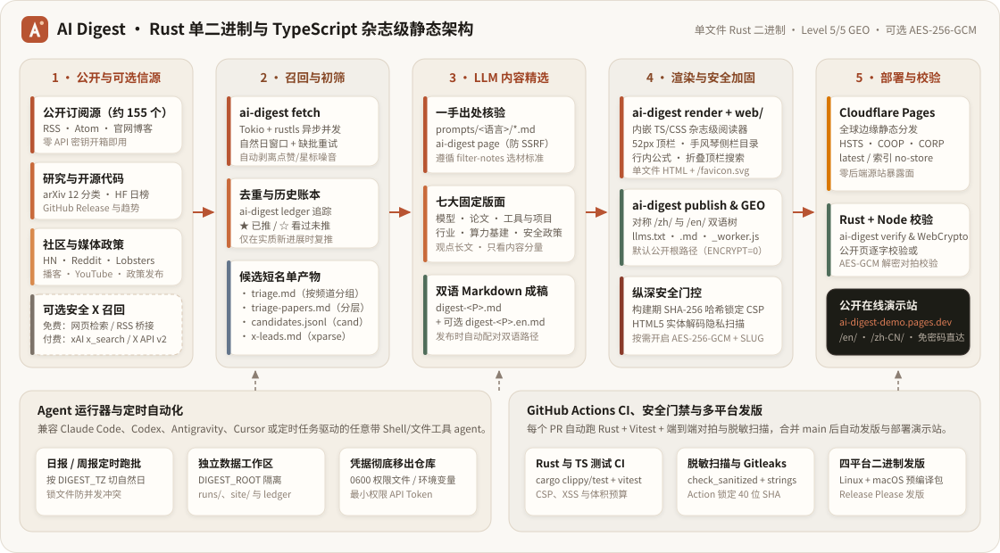

<div align="center">

# AI DIGEST

**由 agent 驱动的 AI 日报 / 周报流水线：汇集约 150 个信源，渲染成单文件 HTML，再以加密静态站点的形式发布。**

[](https://github.com/eatingDream/ai-digest/actions/workflows/ci.yml)
[](LICENSE)


[English](README.md) | 简体中文

[在线演示](https://ai-digest-demo.pages.dev) — 密码 `demo` · [English](https://ai-digest-demo.pages.dev/en/) · [简体中文](https://ai-digest-demo.pages.dev/zh-CN/)


<sub>截图由 <code>examples/</code> 里的合成示例渲染而成。日报与页面支持中英文双语（<code>DIGEST_LANG</code>）。</sub>

</div>

## 特性

- **广覆盖、零密钥**：`fetch/fetch.py` 并行抓取约 150 个信源（RSS、网页、arXiv、Hugging Face、GitHub Release、Hacker News、Reddit），自动去重、打标签、排序，输出精简的初筛清单。
- **分层筛选，内容优先**：`prompts/` 下是与平台无关的 agent 提示词。入选只看内容本身的分量，不看热度数字，范围覆盖整个 AI 领域。
- **不重复推送**：`fetch/ledger.py` 记录「已推送（★）」和「看过未推（☆）」，已推过的内容只有出现实质新进展才会再写。
- **日报 + 周报**：固定七个版面——模型、论文、工具与项目、行业与产品、算力与基础设施、安全与政策、观点与长文。
- **中英双语**：一个开关（`DIGEST_LANG=en|zh-CN`）统一决定提示词、抓取标签和整套阅读界面的语言；`render_html.py --md-en` / `publish.py --md-en`（`zh-CN` 站点下自动发现同目录 `<同名>.en.md`）支持单页内中英文即时切换，`LANG_ALT` 还支持将独立的伴生站点互链，默认英文。
- **好读的页面**：`render_html.py` 生成自包含 HTML，带完整标题侧栏目录、纯前端即时关键词与标签筛选（双语页面各语言独立筛选）、解密后 `#锚点` 自动定位、深浅色主题，大屏下排版舒展。
- **加密静态站点**：`publish.py` 在客户端对每个页面做 AES-256-GCM 加密（PBKDF2-SHA256，60 万次迭代），增量部署到 Cloudflare Pages，并逐页解密校验。
- **自带 CI/CD**：测试、密钥扫描、打 tag 自动发布 Release，以及演示站点工作流（可选部署到 Cloudflare Pages）。

## 架构

<p align="center"></p>

1. **信源**全程只读：约 153 个公开订阅源、论文与代码平台及社区（`fetch/sources.toml`），以及按运行器能力可选启用的 X 只读检索（`fetch/x-recall.zh-CN.md`）。
2. **抓取与初筛**（`fetch/`）是纯脚本，产出 `triage.md`、`triage-papers.md` 和 `candidates.jsonl`；论文另由一个轻量的初筛 agent 先行收窄。
3. **LLM 精选**（`prompts/<语言>/`、`filter-notes.md`、`x-sources.md`）核对一手出处，写成 `digest-<P>.md`。
4. **渲染与加密**：Markdown 转 HTML，注入导航和目录页，对每个页面加密并做解密往返校验。
5. **部署与阅读**：`wrangler pages deploy` 只上传密文，读者在浏览器里用 Web Crypto 解锁页面。

定时任务可以交给任何带 Shell、文件和联网检索能力的 agent 运行器，负责触发日报和周报；GitHub Actions 负责 CI、发布和演示站点。

## 快速开始

环境要求：Python 3.11+（CI 使用 3.12）；Node 20 与 `npx`（仅在用 wrangler 部署时需要）。

```bash
python3 -m venv .venv && . .venv/bin/activate
pip install -r requirements-dev.txt          # requests、lxml、markdown、cryptography、pytest

# 1. 渲染示例日报（加 --md-en 可将中英文合成带切换按钮的单页双语 HTML）
python3 render_html.py examples/sample-digest.zh-CN.md /tmp/sample.html --lang zh-CN
python3 render_html.py examples/sample-digest.zh-CN.md /tmp/bilingual.html --md-en examples/sample-digest.en.md

# 2. 构建加密演示站点（不部署，也不需要任何密钥）
DIGEST_DEMO_PASSWORD='demo' python3 publish.py --demo --out dist/
# 英文在 dist/en/，中文在 dist/zh-CN/；构建时会逐页解密校验
# 加 --lang en（或 zh-CN）则只构建单一语言，输出在 dist/demo/

# 3. 跑测试
pytest -q
```

### 运行你自己的日报

```bash
# 1. 配置站点（自动生成带 22 位随机 SLUG 的 site/CONFIG；可在文件里设 LANG=zh-CN 或 export DIGEST_LANG=zh-CN）
python3 publish.py --init                                # 或 cp site/CONFIG.example site/CONFIG（需替换所有 <...> 占位符）
install -m 600 /dev/stdin ~/.config/ai-digest/site-password   # 粘贴 16 位以上的密码，Ctrl-D 结束
export CLOUDFLARE_API_TOKEN=...                          # 权限范围：Account · Cloudflare Pages · Edit

# 2. 抓取昨天的候选（先设好 DIGEST_TZ；可选设置 GITHUB_TOKEN/GH_TOKEN 提升限额）
python3 fetch/fetch.py --daily                           # 周报用 --weekly（标签语言跟随 DIGEST_LANG / --lang）

# 3. 交给 agent 精选：在你的 agent 运行器里执行 prompts/zh-CN/daily.md（或 weekly.md；英文用 prompts/en/），得到 digest-<P>.md

# 4. 发布（首次执行 ledger.py add 会自动初始化 ledger.json）
python3 publish.py --issue daily/2026-01-15 --md digest-2026-01-15.md
```

其他命令（`--rebuild`、`--rerender-all`、`--rotate-password`、`--remove`）见 [site/README.md](site/README.md)；抓取参数与输出文件见 [fetch/README.md](fetch/README.md)。

## 配合 AI agent 使用

[AGENTS.md](AGENTS.md) 是给编码 agent（Cursor、Claude Code、Codex 等）的入口：仓库地图、常用命令、流水线、约定与安全规则。想让 agent 来产出日报：在带 Shell 与文件读写工具的 agent 运行器里打开仓库根目录，设好 `DIGEST_LANG` 和 `DIGEST_TZ`，把 `prompts/zh-CN/daily.md`（或 `weekly.md`；英文用 `prompts/en/`）交给它。X/Twitter 只读检索工具（`search_posts_all`、`get_users_posts` 等）为**可选增强**：运行器没有 X 工具时提示词会自动干净跳过，直接用约 153 个公开信源完成筛选；若有 X 工具，可在 `fetch/x-recall.zh-CN.md` 与 `x-sources.zh-CN.md` 中替换 `<account_1>` / `<zh_account_1>` 自定义关注圈账号（未替换的占位查询会自动跳过）。每份提示词开头都有「运行契约」，写明输入、产出和完成标准。所有命令行都带 `--help` 和示例，部分支持 `--json`。

## 配置

环境变量优先于 `site/CONFIG`。

| 变量 | `CONFIG` 键 | 说明 | 默认值 |
|---|---|---|---|
| `SITE_DOMAIN` | `DOMAIN` | 站点域名 | `digest.example.com` |
| `SITE_SLUG` | `SLUG` | 不可猜测的路径前缀（至少 8 位 URL 安全字符；发布后不要再改） | 随机生成（`--init`） |
| `CF_ACCOUNT_ID` | `ACCOUNT_ID` | Cloudflare 账号 ID | — |
| `CF_ZONE_ID` | `ZONE_ID` | 域名所在的 zone（可选） | — |
| `CF_PAGES_PROJECT` | `PROJECT` | Cloudflare Pages 项目名 | `ai-digest` |
| `CLOUDFLARE_API_TOKEN` / `_FILE` | — | 部署用 token（仅需 Pages · Edit） | — |
| `DIGEST_SITE_PASSWORD_FILE` | — | 存放站点密码的文件（权限 600） | `~/.config/ai-digest/site-password` |
| `DIGEST_SITE_SALT_FILE` | — | PBKDF2 盐文件（自动生成） | `~/.config/ai-digest/site-salt` |
| `DIGEST_LANG` | `LANG` | 日报与站点界面的语言：`en` 或 `zh-CN`（命令行 `--lang` 优先） | `en` |
| `DIGEST_LANG_ALT` | `LANG_ALT` | 可选的另一语言伴生站点路径/URL（如 `en:/en/`） | — |
| `DIGEST_ROOT_LATEST` | `ROOT_LATEST` | 可选开启根路径 `/latest`、`/daily/latest`、`/weekly/latest` 静态 302 跳转（`1`/`true`/`yes`/`on`；默认关闭以防暴露 `SLUG`；`/<slug>/...latest` 始终自动生成于 `_redirects`） | `0`（关闭） |
| `DIGEST_TZ` | — | 用来划分「自然日」的 IANA 时区 | `UTC` |
| `DIGEST_ROOT` | — | `runs/`、`html/`、`site/`、`ledger.json`、`logs/` 与 `state/` 所在的工作目录 | 仓库根目录 |
| `LEDGER_PATH` | — | 台账 `ledger.json` 路径（首次 `ledger.py add` 自动创建） | `<DIGEST_ROOT>/ledger.json` |
| `DIGEST_PREFERENCES_FILE` | — | 主题偏好权重 JSON（参考 `fetch/preferences.example.json`） | `fetch/preferences.json` |
| `DIGEST_PRIVACY_PATTERNS_FILE` | — | 发布前额外检查的正则 | `site/privacy-patterns.txt` |
| `DIGEST_DEMO_PASSWORD` | — | `publish.py --demo` 使用的密码 | — |
| `GITHUB_TOKEN` / `GH_TOKEN` | — | 可选，抓取时用来提高 GitHub API 限额 | — |

信源清单在 `fetch/sources.toml`，筛选规则在 `filter-notes.zh-CN.md`。

## 目录结构

```text
ai-digest/
├── fetch/              # 召回：fetch.py、ledger.py、sources.toml、X 召回协议
├── prompts/            # 分语言的 agent 提示词：en/、zh-CN/（daily、weekly、papers）
├── i18n.py             # 界面文案、日期格式与标签词表（en / zh-CN）
├── render_html.py      # Markdown → 自包含 HTML
├── publish.py          # 构建、加密、部署、轮换密码、--demo
├── verify_decrypt.mjs  # 无头解密校验
├── site/               # 加密外壳、_headers、CONFIG.example、文档
├── examples/           # 合成示例日报（en、zh-CN）
├── tests/              # pytest 测试
├── AGENTS.md           # 给 AI 编码 agent 的指南（CLAUDE.md 指向它）
├── CHANGELOG.md
├── scripts/            # check_sanitized.sh
├── docs/               # 架构图、截图（中英各一份）
├── filter-notes.md     # 筛选规则（另有 .zh-CN.md）
├── x-sources.md        # 读者偏好画像（模板，另有 .zh-CN.md）
└── licenses/           # 第三方许可全文
```

## CI/CD

| 工作流 | 触发条件 | 作用 |
|---|---|---|
| `ci.yml` | push / PR 到 `main` | `py_compile`、`pytest`、`node --check`、gitleaks 全历史扫描、`scripts/check_sanitized.sh` |
| `release.yml` | 推送 `v*` 标签 | 先跑测试，再创建 GitHub Release，附源码包和演示站点 `dist` 压缩包 |
| `demo.yml` | push 到 `main`（渲染器 / 发布脚本 / 示例 / site）或手动触发 | 构建演示站点，上传为 artifact，并部署到 Cloudflare Pages |

没配置下面的 Secrets 时，演示部署会自动跳过。要启用，请在 **Settings → Secrets and variables → Actions** 中添加：

- Secret `CLOUDFLARE_API_TOKEN`：权限范围只给 **Account · Cloudflare Pages · Edit**
- Secret `CLOUDFLARE_ACCOUNT_ID`
- 可选 Variables：`CF_PAGES_PROJECT`（默认 `ai-digest-demo`）、`DIGEST_DEMO_PASSWORD`（默认 `demo`）

Dependabot 每周更新 GitHub Actions 和 pip 依赖。

## 参与贡献

欢迎提 PR。`main` 受保护，改动需通过 PR 且 CI 全绿，详见 [CONTRIBUTING.zh-CN.md](CONTRIBUTING.zh-CN.md)；安全漏洞请按 [SECURITY.md](SECURITY.md) 私下报告。

## 致谢

`render_html.py` 内嵌 CSS 的设计令牌改编自 [AIHOT](https://github.com/KKKKhazix/AIHOT)（MIT，© 2026 数字生命卡兹克）。详见 [THIRD_PARTY_NOTICES.md](THIRD_PARTY_NOTICES.md) 与 [licenses/AIHOT-MIT.txt](licenses/AIHOT-MIT.txt)。

## 许可

[MIT](LICENSE)：可自由使用、修改和分发，商用也可以。第三方材料仍遵循其各自的许可。
